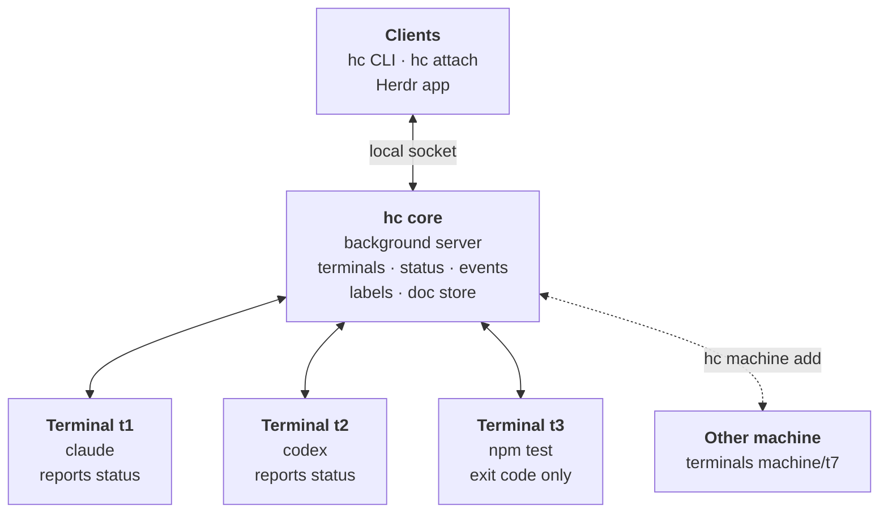
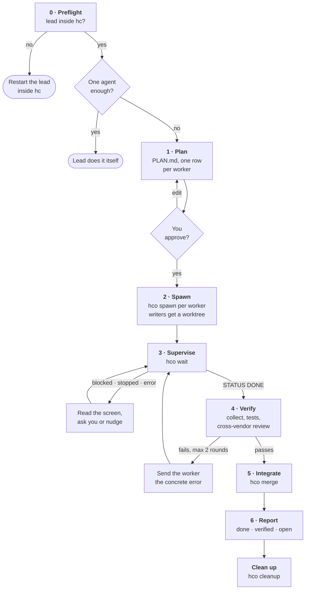
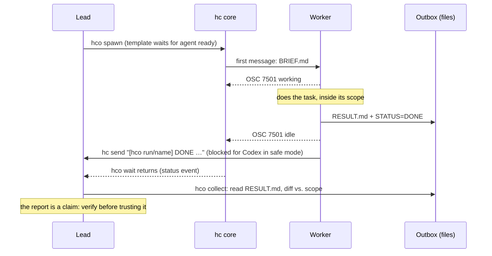
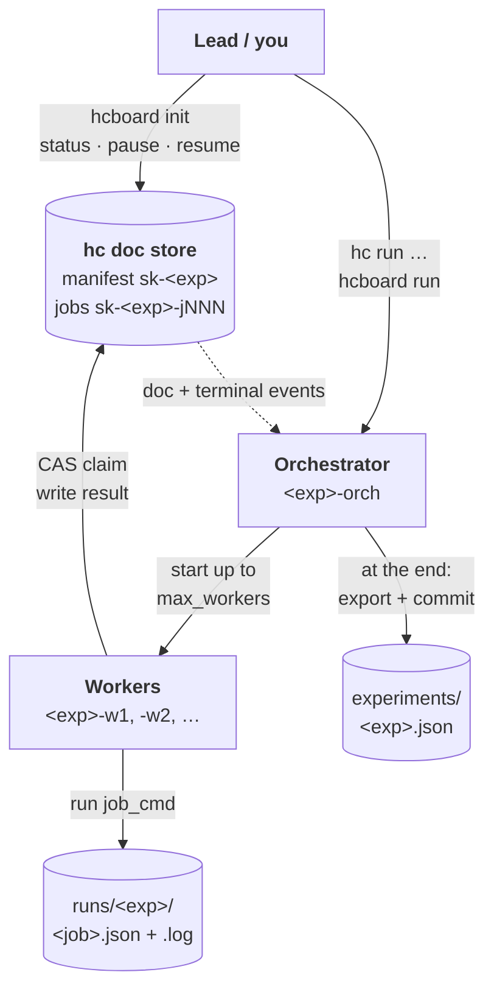
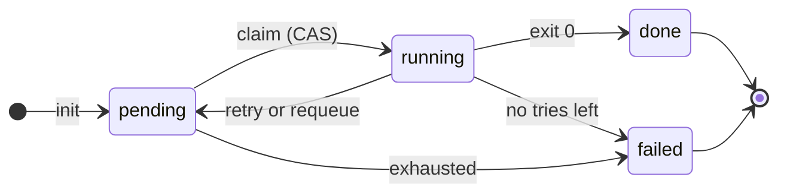
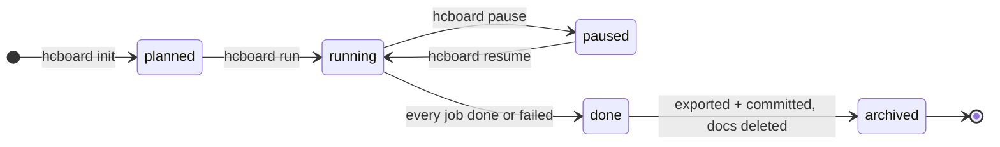

# hc-orchestrate

A skill that turns Claude Code or Codex into a **lead agent** that plans a
complex task, starts a team of Claude Code and Codex workers through
[herdr-core](https://herdr.dev/core/) (`hc`), supervises them, verifies
their work, integrates it and cleans up. For batches of deterministic jobs it
also has a [board mode](#board-mode-batch-jobs-on-the-doc-store) that keeps job
state in herdr-core's doc store, so it survives crashes and context resets.

```
/hc-orchestrate <task>      # Claude Code
$hc-orchestrate <task>      # Codex
```


## How herdr-core works

`hc` talks to the **hc core**, a background server that owns every terminal.
Each terminal runs one program (an agent, a test run, a script). Because the
core holds the terminal, closing your window doesn't stop the program. Agents
report their status to the core through an escape sequence (OSC 7501). Anything
that can reach the core's socket can start, read, message and wait on any
terminal it owns.



"Reports status" means the agent sends OSC 7501 (working, idle, blocked,
error). A plain program like a test run only gives an exit code.

What the skill relies on:
- **Parents and children.** A terminal started from inside another becomes its
  child and ends with it unless started with `--outlive-parent`.
- **Status and waiting.** `hc wait` returns on news from the core: a turn ended,
  blocked, error, exit, or an incoming message.
- **Messages between agents.** `hc send` types into another terminal. The
  message is tagged with the sender's address when both sides report OSC 7501.

## Why hc for this

- **Workers outlive windows.** Each worker runs in an hc terminal that keeps
  going if you close your terminal; you can `hc attach <t>` to watch or take
  over any of them, and Ctrl+\ to leave.
- **Status comes from the agents themselves** (OSC 7501: working, idle,
  blocked, error). Both Claude Code (≥ 2.1.295) and current Codex report it,
  so the lead waits on real events (`hc wait --children any`) instead of
  polling or scraping screens.
- **Agents talk to each other.** Workers report with `hc send <lead>`; the
  lead steers with `hc send`, `hc interrupt`, `hc read`.
- **Mixed vendors, one protocol.** Claude builds, Codex reviews (or the other
  way round), with the same brief and report format.
- **Any machine.** `hc machine add` once, then workers run where the code is.

## What the skill adds on top of hc

| Piece | What it does |
|---|---|
| `SKILL.md` | The lead's playbook: preflight → plan → spawn → supervise → verify → integrate → report → clean up. |
| `scripts/hco.py` | Deterministic helper (stdlib Python): run ids, labels, git worktrees per writer, the worker brief, status tables, result collection, commit-and-merge of worker branches, cleanup scoped to one run. |
| Worker contract | Every brief carries scope rules, "no sub-agents", your policy, and a **two-channel report**: files in an outbox (`RESULT.md` + `STATUS`) and a one-line `hc send` prefixed `[hco <run>/<name>]`. |
| `scripts/hcboard.py`, `docstore_worker.py`, `hcdoc.py` | **Board mode** (stdlib Python): the orchestrator loop, the job-claiming worker and the guarded doc-store helper they share. See below. |
| `templates/hco-claude.md`, `hco-codex.md` | hc templates so core waits for the agent to be ready before handing it the task, and tells the lead if it didn't go in. |
| `references/` | Orchestration recipes, the verified hc facts the skill depends on, and the doc-store notes behind board mode. |

### How a run flows



Why two report channels: hc only tags agent-to-agent messages when both
sides speak OSC 7501, and a sandboxed Codex may not be allowed to reach
hc's socket. The outbox files work regardless, and the lead learns a worker
stopped from hc's status events either way.



## Board mode: batch jobs on the doc store

For a grid of independent jobs that run a **fixed command** (cases × variants, no
agent judgment). The lead proposes it as one row of its plan and starts it only
after you approve; without it the skill behaves as above.

- **State lives in herdr-core**, in versioned docs: a manifest `sk-<exp>` (the plan,
  written by the orchestrator and by you) and one doc per job `sk-<exp>-jNNN`.
  Workers claim a job with a compare-and-set write, so there are no locks and exactly
  one claimer wins.
- **Events, not polling.** `hcboard run` subscribes to doc and terminal events, and
  re-reads everything (reconcile) on startup, manifest changes, worker exit, `missed`
  and every 30 s. A worker that dies has its job requeued; a failed job is retried by
  the worker until `max_attempts`.
- **Survives crashes.** Kill a worker, the orchestrator or the lead: rerun
  `hcboard run <exp>` and it continues from the docs. Workers outlive the orchestrator.
- **Ends tidy.** Export to `experiments/<exp>.json`, git commit, manifest `archived`,
  docs deleted (their versions are kept), finished worker terminals removed.
- **Lineage.** A rerun with changed preconditions is a new experiment:
  `init e052 --spec s.json --parent e051 --delta '{"macros":true}'`.



Each job doc moves through these states. Every transition is a guarded
compare-and-set on the doc (`if state/owner/attempt …`), so a stale writer loses
instead of overwriting newer work. A worker claims a job by setting itself as
owner. A job goes back to `pending` when `job_cmd` fails with attempts left
(retry), or when its owner's terminal dies (the orchestrator requeues it). It
ends `failed` when either happens on the last attempt:



The manifest has its own, coarser lifecycle:



What the orchestrator does on each event, and how it ends:


```sh
S=~/.claude/skills/hc-orchestrate/scripts
python3 $S/hcboard.py init e051 --spec spec.json        # job docs + manifest (planned)
hc run --bg --name e051-orch --outlive-parent --cwd "$PWD" -- python3 $S/hcboard.py run e051
hc wait e051-orch --timeout 100; hc read e051-orch --lines 40
python3 $S/hcboard.py status e051      # also: pause e051 | resume e051
```

`spec.json`: `question`, `cases`, `variants`, `job_cmd` (argv with `{case} {variant}
{out} {job} {exp} {attempt}`), `max_workers`, `max_attempts`, optional `pre`, `out_dir`,
`job_timeout_s`. Needs an hc whose core has `doc.get`/`doc.set` (checked at `init`; exit 4
otherwise, then use the normal flow).

Rules and guards: `job_cmd` must be safe to run twice (delivery is at-least-once);
docs are unencrypted, so no secrets in specs or docs; only `sk-` docs are touched and
never `herdr-app`; `zowe` anywhere in `job_cmd` is refused; the orchestrator touches only
terminals labeled `hco.board=<exp>`. Design, verified hc behavior and limits:
`references/hc-docstore-notes.md`; a visual walkthrough: `hc-orchestrate-workflow.html`
(repo root).

## Install

Prerequisites: `hc` (`curl -fsSL https://releases.herdr.dev/core/install.sh | sh`),
Python 3.8+, git, and `claude` and/or `codex` logged in.

```sh
sh install.sh            # copies the skill to ~/.claude/skills and ~/.agents/skills,
                         # and the templates to ~/.config/herdr-core/templates
```

On Windows, copy the folder by hand into `%USERPROFILE%\.claude\skills\` and
`%USERPROFILE%\.agents\skills\`, and the templates into
`%APPDATA%\herdr-core\templates\` (hc needs `sh` on PATH there, e.g. Git for Windows).

### Run the lead inside hc

Workers report to the lead's hc terminal, so the lead must live in one:

```sh
hc run --bg --name lead --cwd "$PWD" claude && hc attach lead
hc run --bg --name lead --cwd "$PWD" codex --no-daemon && hc attach lead
```

(Or start the agent from the Herdr app, which runs it in hc.) Then:

```
/hc-orchestrate add rate limiting to the public API, with tests and a review
```

### Smoke test (cheap, 2 minutes)

Inside the lead, ask: `/hc-orchestrate spawn one claude and one codex worker
that each write a haiku about this repo to RESULT.md; no file changes`. You
should see two workers start, report `DONE`, and `collect` show their
results with "unchanged since this worker started".

## Configure

- **Policy (recommended).** Rules every worker must follow go in
  `~/.config/hc-orchestrate/policy.md` (personal) or
  `<repo>/.hc-orchestrate-policy.md` (shared with the repo). They're appended
  to every brief and override the task. Use this for anything an agent must
  never do on its own, e.g. commands only a person may run.
- **Worker permissions: bypass by default.** Workers run with approvals and the
  sandbox off (Claude `--dangerously-skip-permissions`, Codex
  `--dangerously-bypass-approvals-and-sandbox`; set in the templates and in
  `hco.py`). Scope, "no sub-agents" and policy are then only instructions in the
  brief, not enforced, and a worker can read any file you can (`~/.ssh`, credential
  files such as `~/.broadcom-creds`). `hco spawn --permissions safe` restores the careful mode: Claude
  `--permission-mode acceptEdits` plus an allow rule for `hc send`; Codex
  `--sandbox workspace-write --ask-for-approval on-request`. In safe mode a worker
  that hits a prompt goes `blocked` and you answer with `hc attach <t>`.
  Claude may show a one-time bypass-mode warning, and any agent still shows its
  folder-trust dialog on new folders; both need a person.
- **Env scrub (on by default).** Workers get the hc core's environment (not your shell's).
  Before the agent starts, anything secret-looking in it is unset: names containing
  TOKEN, SECRET, PASSW, CREDENTIAL, API_KEY, PRIVATE, ACCESS_KEY, COOKIE or AUTH
  (so also `SSH_AUTH_SOCK`), and `MAINFRAME_`, `RALLY_`, `JENKINS_`, `ZOWE_`, `AWS_`,
  `AZURE_`, `GCP_`, `GH_`, `GITHUB_`, `NPM_` prefixes. Agent login variables
  (`ANTHROPIC_*`, `OPENAI_*`, `CODEX_*`, `CLAUDE*`) and `HC_*` are kept. It does not
  cover files on disk. `hco spawn --no-scrub` turns it off for a worker. The scrub
  line is in the templates' `command:` and in `hco.py` (`SCRUB_SH`); a test keeps them equal.
- **Codex reasoning effort:** workers are pinned to `model_reasoning_effort=high` (templates and
  `hco.py` `AGENT_ARGV`), so they do not inherit `~/.codex/config.toml` (e.g. `xhigh`). The model still
  comes from your Codex config. To change it, edit both places (a test keeps them equal).
- **Folder-trust prompt:** `hco spawn --trust` pre-accepts it for the worker's folder (a new worktree
  counts as a new folder). It sets `projects[<cwd>].hasTrustDialogAccepted` in `~/.claude.json`, or adds
  `[projects."<cwd>"] trust_level = "trusted"` to `~/.codex/config.toml`; other entries are kept, and a
  Codex entry that is explicitly not trusted is left alone. Local only (rejected with `--on`). Opt-in:
  trusted folders get their project hooks, MCP servers and settings honored, so use it only for folders you
  would trust anyway. Claude rewrites `~/.claude.json` itself, so a spawn that races it can lose the edit;
  rerun if the prompt still appears.
- **Models:** add `--model ...` to a template's command, or pass
  `--model` to `hco.py spawn` for one worker.
- **Fewer prompts for the lead (Claude Code):** allow the read-only hc
  commands in `~/.claude/settings.json`:
  ```json
  { "permissions": { "allow": [
    "Bash(hc ls *)", "Bash(hc get *)", "Bash(hc read *)", "Bash(hc wait *)",
    "Bash(hc templates *)", "Bash(python3 ~/.claude/skills/hc-orchestrate/scripts/hco.py status *)",
    "Bash(python3 ~/.claude/skills/hc-orchestrate/scripts/hco.py wait *)",
    "Bash(python3 ~/.claude/skills/hc-orchestrate/scripts/hco.py collect *)" ] } }
  ```
  Don't blanket-allow `hc run`/`hc exec`: they run arbitrary commands
  outside your agent's per-command rules.

## Files a run creates

```
<repo>/.git/info/exclude              + /.hc-orchestrate/ and check artifacts
                                       (__pycache__/, *.pyc, .pytest_cache/, node_modules/, .DS_Store, …)
<repo>/.hc-orchestrate/<run>/          (git-ignored via .git/info/exclude)
  run.json                             run + worker records
  PLAN.md                              the lead's plan
  wt/<worker>/                         git worktree, branch hco/<run>/<worker>
  workers/<worker>/BRIEF.md            copy of each brief; outboxes archived here on cleanup
<worker cwd>/.hc-orchestrate/<run>/out/<worker>/
  BRIEF.md  RESULT.md  STATUS          the worker's outbox (on another machine with --on:
                                       git-excluded there too, deleted by cleanup)
```

Board mode writes, under the repo you pass as `--cwd`: `runs/<exp>/<job>.json` and `.log`
per job, and `experiments/<exp>.json` (manifest + every job doc, committed at the end).

## Known limits

- Live-tested on hc 0.1.17 (one Claude writer in a worktree plus one Codex reviewer, and a
  single Claude worker) and on hc 0.1.18 (templates, a Claude and a Codex writer in worktrees,
  `merge`, `cleanup --worktrees`, and `--on` with Claude and Codex workers on a Linux machine);
  see CHANGES.md.
- `merge` commits everything new in a worktree that git doesn't ignore. `init` excludes common
  check artifacts, but anything else a worker leaves behind would be committed: run
  `hco merge --dry-run` first and remove files outside the worker's scope.
- In `--permissions safe`, Codex's sandbox blocks `hc send` (verified live); its reports then
  travel as outbox files plus hc status events. In the default bypass mode it works.
- A brand-new folder (e.g. a fresh worktree) may show the agent's
  folder-trust prompt. The template run then reports the task as not sent;
  the lead asks you to approve it in that terminal.
- Remote workers (`--on`) use direct commands, not templates, and need `python3` on that
  machine. `hco` snapshots the remote checkout at spawn so `collect` can list what changed
  (shared with any other worker in that folder; no snapshot if it isn't a git repo), and
  `cleanup` deletes the remote outbox after archiving it. `--trust` is local only, so a new
  remote folder's trust prompt must be accepted by you (`hc attach machine/t7`).
- Board mode (live-tested on hc 0.1.17 in an isolated session, with a fake job): one
  orchestrator per experiment; remote owners (`machine/t7`) are never requeued; workers
  emit no OSC 7501 status (the report format is not in `hc --skill`), they print progress
  lines instead; every reconcile re-reads all job docs (fine for hundreds).
