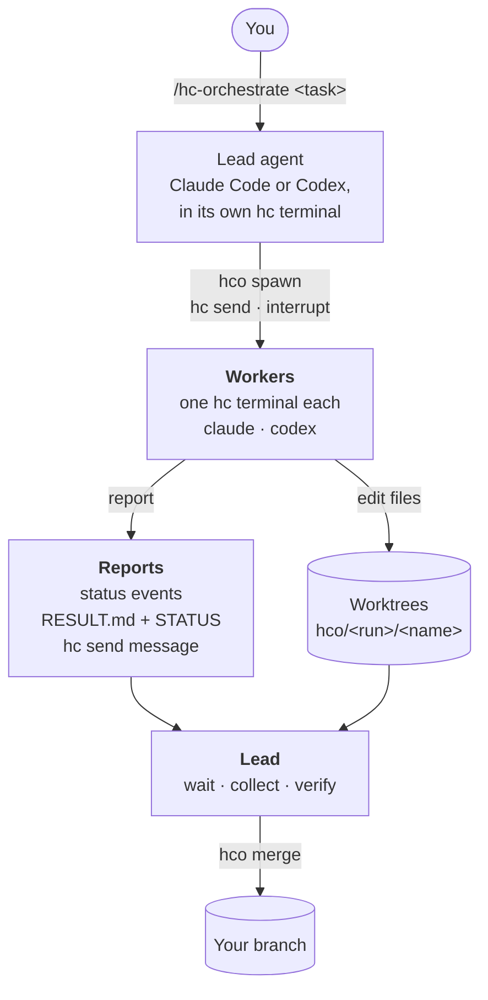
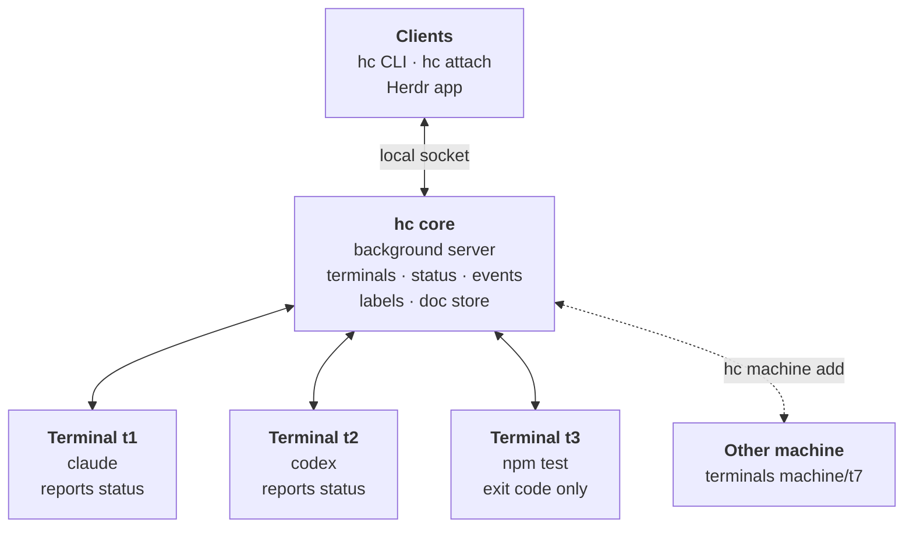
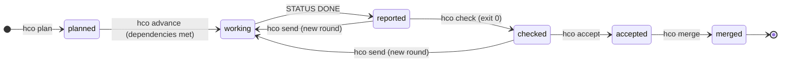
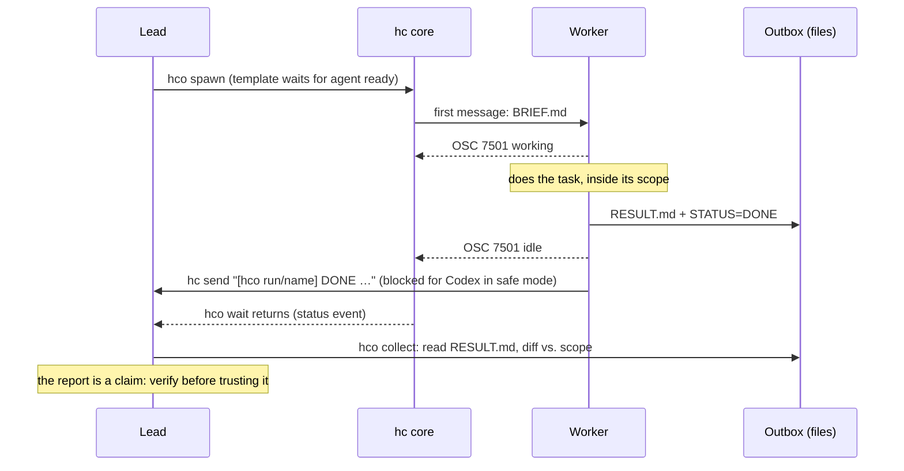
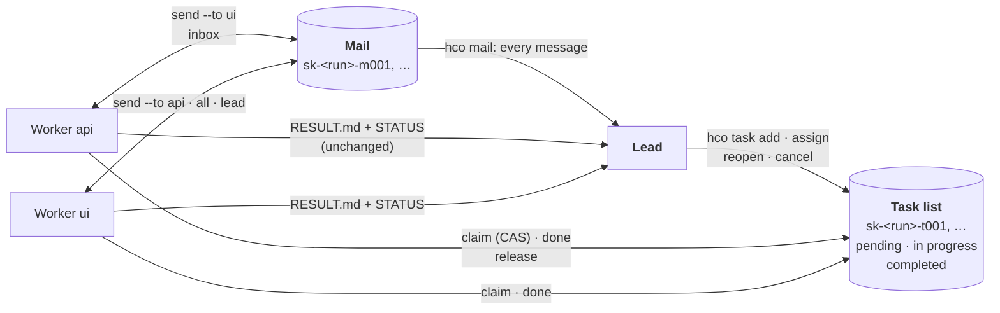
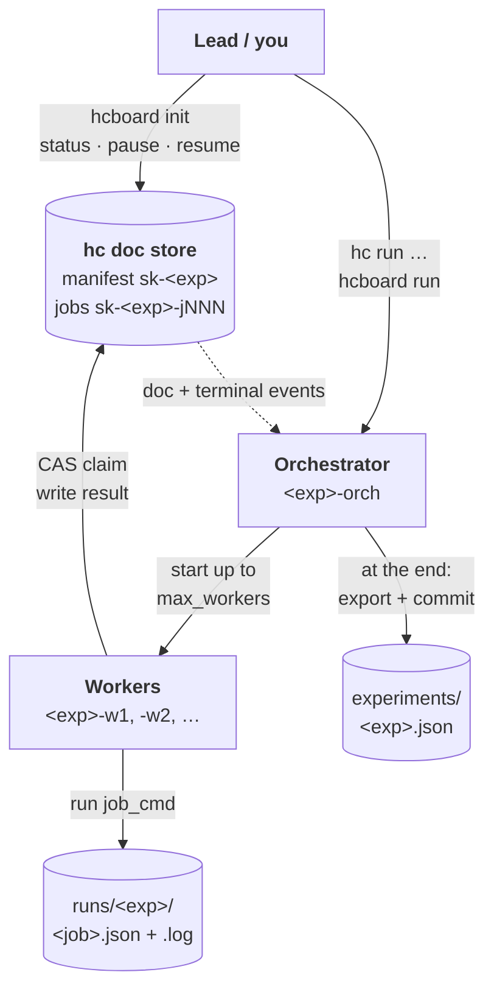
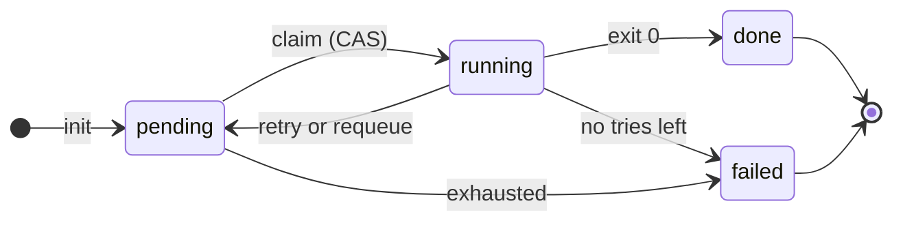
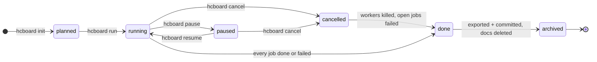
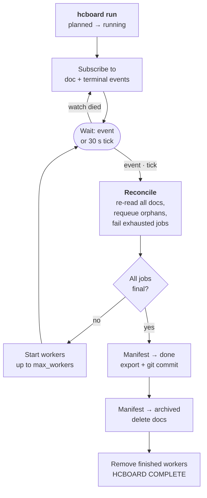

# hc-orchestrate

A skill that turns Claude Code or Codex into a **lead agent** that plans a
complex task, starts a team of Claude Code and Codex workers through
[herdr-core](https://herdr.dev/core/) (`hc`), supervises them, verifies
their work, integrates it and cleans up. For batches of deterministic jobs it
also has a [board mode](#board-mode-batch-jobs-on-the-doc-store) that keeps job
state in herdr-core's doc store, so it survives crashes and context resets.

```
/hc-orchestrate <task>      # Claude Code
$hc-orchestrate <task>      # Codex
```



## How herdr-core works

`hc` talks to the **hc core**, a background server that owns every terminal.
Each terminal runs one program (an agent, a test run, a script). Because the
core holds the terminal, closing your window doesn't stop the program. Agents
report their status to the core through an escape sequence (OSC 7501). Anything
that can reach the core's socket can start, read, message and wait on any
terminal it owns.



"Reports status" means the agent sends OSC 7501 (working, idle, blocked,
error). A plain program like a test run only gives an exit code.

What the skill relies on:
- **Parents and children.** A terminal started from inside another becomes its
  child and ends with it unless started with `--outlive-parent`.
- **Status and waiting.** `hc wait` returns on news from the core: a turn ended,
  blocked, error, exit, or an incoming message.
- **Messages between agents.** `hc send` types into another terminal. The
  message is tagged with the sender's address when both sides report OSC 7501.

## Why hc for this

- **Workers outlive windows.** Each worker runs in an hc terminal that keeps
  going if you close your terminal; you can `hc attach <t>` to watch or take
  over any of them, and Ctrl+\ to leave.
- **Status comes from the agents themselves** (OSC 7501: working, idle,
  blocked, error). Both Claude Code (≥ 2.1.295) and current Codex report it,
  so the lead waits on real events (`hc wait --children any`) instead of
  polling or scraping screens.
- **Agents talk to each other.** Workers report with `hc send <lead>`; the
  lead steers with `hc send`, `hc interrupt`, `hc read`.
- **Mixed vendors, one protocol.** Claude builds, Codex reviews (or the other
  way round), with the same brief and report format.
- **Any machine.** `hc machine add` once, then workers run where the code is.

## What the skill adds on top of hc

| Piece | What it does |
|---|---|
| `SKILL.md` | The lead's playbook: preflight → plan → spawn → supervise → verify → integrate → report → clean up. |
| `scripts/hco.py` | Deterministic helper (stdlib Python): run ids, labels, git worktrees per writer, the worker brief, status tables, result collection, commit-and-merge of worker branches, cleanup scoped to one run. |
| Plan as data | `hco plan --file plan.json` validates the split (names, dependency cycles, parallel writers whose scopes may share a file) and stores it; `hco advance` starts every worker whose dependencies hold, up to `max_parallel`, and says what still waits and why. |
| Checks and gates | `spawn --check '<cmd>'` names the command that proves a worker's work. `hco check` runs it in an hc terminal and records the result with the content it ran on; `hco accept` records the lead's verdict. `merge` refuses a worker whose check hasn't passed on its current files or that changed after it was accepted. |
| Rounds | `hco send` turns a correction into a counted follow-up round: the text goes to a file in the outbox, the previous STATUS/RESULT.md are kept under a round suffix, and the third round is the last. |
| Run state | `run.json` is written under a lock with a fresh read (parallel `spawn` calls are safe), a failed spawn rolls its worktree back, every action lands in a journal (`hco log`, `hco report`), and a restarted lead takes the run over with `hco runs` + `hco adopt`. |
| Worker contract | Every brief carries scope rules, "no sub-agents", your policy, and a **two-channel report**: files in an outbox (`RESULT.md` + `STATUS`) and a one-line `hc send` prefixed `[hco <run>/<name>]`. |
| Scope check | `spawn --scope 'src/auth/**'` records the files a writer may change and lists them in its brief; `collect` flags any other file it changed (renames and deletions included) and `merge` refuses to commit them. `hco scope --add` widens one worker's scope. |
| Team mode | Optional (`hco init --team`), modelled on Claude Code's agent teams: a shared task list the workers claim from (dependencies, assignment, atomic claims) and mail between members, in herdr-core's doc store (`scripts/hcteam.py`). The lead sees every task change and every message. See [below](#team-mode-shared-task-list-and-mail). |
| `scripts/hcboard.py`, `docstore_worker.py`, `hcdoc.py` | **Board mode** (stdlib Python): the orchestrator loop, the job-claiming worker and the guarded doc-store helper they share. See below. |
| `templates/hco-claude.md`, `hco-codex.md` | hc templates so core waits for the agent to be ready before handing it the task, and tells the lead if it didn't go in. |
| `references/` | Orchestration recipes, the verified hc facts the skill depends on, and the doc-store notes behind board mode. |

### How a run flows


A run with a stored plan moves each worker through these gates. Every arrow is a
command the lead runs; `hco status` shows the next one per worker in its `NEXT` column:



A file that changes after `check` or `accept` puts the worker back before that gate:
both record the git tree id of the folder's content, and `merge` compares it again.

Why two report channels: hc only tags agent-to-agent messages when both
sides speak OSC 7501, and a sandboxed Codex may not be allowed to reach
hc's socket. The outbox files work regardless, and the lead learns a worker
stopped from hc's status events either way.



## Team mode: shared task list and mail

Without it, each worker gets one brief and talks only to the lead. `hco init --task "..." --team`
adds the two things [Claude Code's agent teams](https://code.claude.com/docs/en/agent-teams) are
built on: a **task list** the workers claim from, and a **mailbox** per member.



| Agent teams | Here |
|---|---|
| Tasks are pending, in progress or completed; a task can depend on others and is blocked until they are completed | Same, plus `cancelled`. `--after` names the tasks to wait for. |
| The lead assigns, or teammates self-claim the next unassigned, unblocked task | Same: `--for <name>` assigns; `claim` takes the lowest-numbered task the member may take. One task at a time. |
| Claiming uses file locking | A compare-and-set on the task's doc: of two claimers exactly one wins. |
| A teammate messages one teammate by name; to reach everyone it sends one message each | `send --to <name>`, `--to lead`, and `--to all` as one stored message. |
| Messages are delivered automatically | Stored first; the recipient is told only if it is idle (`hc send --if idle`). A working agent is not interrupted: every team command it runs says `mail: n unread`. |
| The lead is told when a teammate goes idle | Unchanged from the normal flow: STATUS file, `hc send` report, hc status events. |
| `TaskCompleted` hooks can reject a completion | `hco task reopen --id n --why "..."` sends it back. `completed` is a claim; `check`, `accept` and `merge` still gate each worker. |
| "Two teammates editing the same file leads to overwrites": the docs advise that each owns a different set of files | Writers keep their worktrees and `--scope`. Assign tasks (`--for`) where only one worker's scope fits. |

Where it deliberately differs:

- **The lead reads all mail**, also between two workers (`hco mail`, `collect`, the journal). The
  skill's rule is that a report is a claim to verify, and mail reaches workers without passing the
  lead.
- **Mail and task notes are marked as claims.** The brief tells members to check them against the
  code, never to leave their scope because of one, and to name the messages they relied on.
- **Authors are checked.** A member acts under its own name only (its terminal must be the one
  `hco` started for that name), and the lead's views flag a message whose terminal doesn't fit.
- **Only the lead adds tasks.** A worker that sees missing work writes to the lead.
- **Bounded.** 100 tasks, 400 messages, 40 per worker, 500 characters each.

```sh
hco init --task "rate limiting for the public API" --team    # exit 4: this hc has no doc store
hco spawn --run k3x9 --name api --agent claude --worktree --scope 'src/api/**' --brief api.md
hco task add --run k3x9 --title "token bucket limiter with tests"
hco task add --run k3x9 --title "wire it into the router" --after 1 --for api
hco tasks --run k3x9                                          # who holds what, what waits
hco mail  --run k3x9                                          # every message, flags included
hco mail  --run k3x9 --to ui "the limiter returns 429 with Retry-After"
hco task reopen --run k3x9 --id 1 --why "test_burst fails: <error>"
# what a worker runs (the exact commands are in its brief):
python3 $S/hcteam.py claim --run k3x9 --as api
python3 $S/hcteam.py done  --run k3x9 --as api 1 --note "limiter.py; 6 tests pass"
python3 $S/hcteam.py send  --run k3x9 --as api --to ui "getUser is now fetchUser(id, opts)"
python3 $S/hcteam.py inbox --run k3x9 --as api
```

Who is a member: local workers in the default bypass mode. A worker on another machine (`--on`)
has neither this core's doc store nor the script, and in `--permissions safe` the command would
stop Claude at a permission prompt and Codex's sandbox blocks the core's socket; `spawn` warns for
both, and such a worker needs its whole task in its brief.

Task dependencies are about order, not about code: writers work in separate worktrees, so a task
that needs another worker's code can't see it before the lead merged it. Order that with a plan
(`after: ["build:merged"]`).

## Board mode: batch jobs on the doc store

For a grid of independent jobs that run a **fixed command** (cases × variants, no
agent judgment). The lead proposes it as one row of its plan and starts it only
after you approve; without it the skill behaves as above.

- **State lives in herdr-core**, in versioned docs: a manifest `sk-<exp>` (the plan,
  written by the orchestrator and by you) and one doc per job `sk-<exp>-jNNN`.
  Workers claim a job with a compare-and-set write, so there are no locks and exactly
  one claimer wins.
- **Events, not polling.** `hcboard run` subscribes to doc and terminal events, and
  re-reads everything (reconcile) on startup, manifest changes, worker exit, `missed`
  and every 30 s. A worker that dies has its job requeued; a failed job is retried by
  the worker until `max_attempts`.
- **Survives crashes.** Kill a worker, the orchestrator or the lead: rerun
  `hcboard run <exp>` and it continues from the docs. Workers outlive the orchestrator.
- **Ends tidy.** Export to `experiments/<exp>.json`, git commit, manifest `archived`,
  docs deleted (their versions are kept), finished worker terminals removed.
- **Lineage.** A rerun with changed preconditions is a new experiment:
  `init e052 --spec s.json --parent e051 --delta '{"macros":true}'`. To rerun only what failed:
  `init e052 --retry-failed e051` builds the child from the failed jobs in `experiments/e051.json`.
- **Fails early, stops cleanly.** `run` refuses before the first job when the export could not be
  committed at the end (not a git repo, path ignored, no git identity) or `job_cmd` can't start.
  `hcboard cancel` kills the experiment's workers and their jobs, fails what is unfinished as
  `cancelled`, then exports and archives like a normal end.
- **Retries can wait.** With `retry_delay_s` a failed job is not retried at once but after the delay,
  doubled per attempt (at most 10 minutes); the worker stays alive while it waits.



Each job doc moves through these states. Every transition is a guarded
compare-and-set on the doc (`if state/owner/attempt …`), so a stale writer loses
instead of overwriting newer work. A worker claims a job by setting itself as
owner. A job goes back to `pending` when `job_cmd` fails with attempts left
(retry), or when its owner's terminal dies (the orchestrator requeues it). It
ends `failed` when either happens on the last attempt:



The manifest has its own, coarser lifecycle:



What the orchestrator does on each event, and how it ends:



```sh
S=~/.claude/skills/hc-orchestrate/scripts
python3 $S/hcboard.py init e051 --spec spec.json        # job docs + manifest (planned)
hc run --bg --name e051-orch --outlive-parent --cwd "$PWD" -- python3 $S/hcboard.py run e051
hc wait e051-orch --timeout 100; hc read e051-orch --lines 40
python3 $S/hcboard.py status e051      # also: pause e051 | resume e051 | cancel e051
python3 $S/hcboard.py init e052 --retry-failed e051     # afterwards: only e051's failed jobs
```

`spec.json`: `question`, `cases`, `variants`, `job_cmd` (argv with `{case} {variant}
{out} {job} {exp} {attempt}`), `max_workers`, `max_attempts`, optional `pre`, `out_dir`,
`job_timeout_s`, `retry_delay_s`, and `pairs` (`[[case, variant], ...]` instead of the full
grid). Needs an hc whose core has `doc.get`/`doc.set` (checked at `init`; exit 4
otherwise, then use the normal flow).

`status` also prints the time so far, the mean time per finished job, a rough time left
(unfinished jobs × mean ÷ workers) and done/failed/open per variant; `--json` has the same
under `stats` and `variants`.

Rules and guards: `job_cmd` must be safe to run twice (delivery is at-least-once);
docs are unencrypted, so no secrets in specs or docs; only `sk-` docs are touched and
never `herdr-app`; `zowe` anywhere in `job_cmd` is refused; the orchestrator touches only
terminals labeled `hco.board=<exp>`. Design, verified hc behavior and limits:
`references/hc-docstore-notes.md`; a visual walkthrough: `hc-orchestrate-workflow.html`
(repo root).

## Install

Prerequisites: `hc` (`curl -fsSL https://releases.herdr.dev/core/install.sh | sh`),
Python 3.8+, git, and `claude` and/or `codex` logged in.

```sh
sh install.sh            # copies the skill to ~/.claude/skills and ~/.agents/skills,
                         # and the templates to ~/.config/herdr-core/templates
```

On Windows, copy the folder by hand into `%USERPROFILE%\.claude\skills\` and
`%USERPROFILE%\.agents\skills\`, and the templates into
`%APPDATA%\herdr-core\templates\` (hc needs `sh` on PATH there, e.g. Git for Windows).

### Run the lead inside hc

Workers report to the lead's hc terminal, so the lead must live in one:

```sh
hc run --bg --name lead --cwd "$PWD" claude && hc attach lead
hc run --bg --name lead --cwd "$PWD" codex --no-daemon && hc attach lead
```

(Or start the agent from the Herdr app, which runs it in hc.) Then:

```
/hc-orchestrate add rate limiting to the public API, with tests and a review
```

Tests: `python3 -I -m unittest discover -s tests` (the `*_live.py` ones skip without `hc`).

### Smoke test (cheap, 2 minutes)

Inside the lead, ask: `/hc-orchestrate spawn one claude and one codex worker
that each write a haiku about this repo to RESULT.md; no file changes`. You
should see two workers start, report `DONE`, and `collect` show their
results with "unchanged since this worker started".

## Configure

- **Policy (recommended).** Rules every worker must follow go in
  `~/.config/hc-orchestrate/policy.md` (personal) or
  `<repo>/.hc-orchestrate-policy.md` (shared with the repo). They're appended
  to every brief and override the task. Use this for anything an agent must
  never do on its own, e.g. commands only a person may run.
- **Worker permissions: bypass by default.** Workers run with approvals and the
  sandbox off (Claude `--dangerously-skip-permissions`, Codex
  `--dangerously-bypass-approvals-and-sandbox`; set in the templates and in
  `hco.py`). Scope, "no sub-agents" and policy are then only instructions in the
  brief, not enforced while the worker runs (`--scope` detects stray files in the repo
  afterwards, at `collect` and `merge`; it can't see files outside the repo or
  anything git ignores), and a worker can read any file you can (`~/.ssh`, credential
  files such as `~/.broadcom-creds`). `hco spawn --permissions safe` restores the careful mode: Claude
  `--permission-mode acceptEdits` plus an allow rule for `hc send`; Codex
  `--sandbox workspace-write --ask-for-approval on-request`. In safe mode a worker
  that hits a prompt goes `blocked` and you answer with `hc attach <t>`.
  Claude may show a one-time bypass-mode warning, and any agent still shows its
  folder-trust dialog on new folders; both need a person.
- **Env scrub (on by default).** Workers get the hc core's environment (not your shell's).
  Before the agent starts, anything secret-looking in it is unset: names containing
  TOKEN, SECRET, PASSW, CREDENTIAL, API_KEY, PRIVATE, ACCESS_KEY, COOKIE or AUTH
  (so also `SSH_AUTH_SOCK`), and `MAINFRAME_`, `RALLY_`, `JENKINS_`, `ZOWE_`, `AWS_`,
  `AZURE_`, `GCP_`, `GH_`, `GITHUB_`, `NPM_` prefixes. Agent login variables
  (`ANTHROPIC_*`, `OPENAI_*`, `CODEX_*`, `CLAUDE*`) and `HC_*` are kept. It does not
  cover files on disk. `hco spawn --no-scrub` turns it off for a worker. The scrub
  line is in the templates' `command:` and in `hco.py` (`SCRUB_SH`); a test keeps them equal.
- **Codex reasoning effort:** workers are pinned to `model_reasoning_effort=high` (templates and
  `hco.py` `AGENT_ARGV`), so they do not inherit `~/.codex/config.toml` (e.g. `xhigh`). The model still
  comes from your Codex config. To change it, edit both places (a test keeps them equal).
- **Folder-trust prompt:** `hco spawn --trust` pre-accepts it for the worker's folder (a new worktree
  counts as a new folder). It sets `projects[<cwd>].hasTrustDialogAccepted` in `~/.claude.json`, or adds
  `[projects."<cwd>"] trust_level = "trusted"` to `~/.codex/config.toml`; other entries are kept, and a
  Codex entry that is explicitly not trusted is left alone. Local only (rejected with `--on`). Opt-in:
  trusted folders get their project hooks, MCP servers and settings honored, so use it only for folders you
  would trust anyway. Claude rewrites `~/.claude.json` itself, so a spawn that races it can lose the edit;
  rerun if the prompt still appears.
- **Models:** add `--model ...` to a template's command, or pass
  `--model` to `hco.py spawn` for one worker.
- **Fewer prompts for the lead (Claude Code):** allow the read-only hc
  commands in `~/.claude/settings.json`:
  ```json
  { "permissions": { "allow": [
    "Bash(hc ls *)", "Bash(hc get *)", "Bash(hc read *)", "Bash(hc wait *)",
    "Bash(hc templates *)", "Bash(python3 ~/.claude/skills/hc-orchestrate/scripts/hco.py status *)",
    "Bash(python3 ~/.claude/skills/hc-orchestrate/scripts/hco.py wait *)",
    "Bash(python3 ~/.claude/skills/hc-orchestrate/scripts/hco.py collect *)" ] } }
  ```
  Don't blanket-allow `hc run`/`hc exec`: they run arbitrary commands
  outside your agent's per-command rules.

## Plans, checks and rounds

```sh
hco init --task "rate limiting for the public API"       # prints the run id, e.g. k3x9
hco plan    --run k3x9 --file plan.json                   # validate + store; prints the steps
hco advance --run k3x9                                    # start what is ready (JSON: started, waiting, why)
hco wait    --run k3x9 --timeout 100                      # status table with a NEXT column
hco check   --run k3x9 --name build                       # run its check in an hc terminal; 0 / 1 / 124
hco send    --run k3x9 --name build --text "test_burst fails: <error>"   # round 2
hco accept  --run k3x9 --name build --note "read the diff, check passed"
hco merge   --run k3x9 --name build                       # refuses if it changed since check/accept
hco advance --run k3x9                                    # now starts what waited for build
hco report  --run k3x9                                    # Markdown summary + timeline
```

`plan.json` is `{"max_parallel": 4, "workers": [...]}`; a worker has `name`, `agent`,
`brief` (a path relative to the plan file) and any of `role`, `scope`, `worktree`, `cwd`,
`base`, `on`, `check`, `deadline_min`, `max_rounds`, `after`, `permissions`, `model`,
`direct`, `no_scrub`, `outlive`, `trust`. Unknown keys are refused.

- **`after`** lists what must hold before the worker starts: `"build:done"` (STATUS DONE and,
  if it has a check, the check passed on its current files), `"build"` (the lead ran
  `hco accept`), `"build:merged"`. A reviewer takes `"cwd": "@build"` and `"after":
  ["build:done"]`; a writer that builds on another writer's code takes `"build:merged"`, so
  its worktree starts from a commit that contains it.
- **Scope overlap.** Two writers that can run at the same time (neither waits for the other)
  must have scopes that provably share no file, or `plan` refuses; `--allow-overlap` stores it
  anyway. The test errs on the side of refusing: two wildcard segments at the same depth
  (`src/a*` and `src/b*`) count as overlapping.
- **The check** runs with `sh -c` in the worker's folder with its output in
  `.hc-orchestrate/<run>/checks/<worker>.log`. `hco check` returns 124 when it is still running
  after `--timeout` (default 100 s); the same command picks the running check up again. A
  result only counts for the content it ran on: if a file changed while it ran, it is reported
  as not counted, and any later change makes `collect`, `accept` and `merge` treat it as not run.
  Checks that write files git doesn't ignore therefore need those files excluded.
- **The tree id** is what `git write-tree` gives for the folder's tracked and untracked files
  (ignored files and outboxes left out), computed with a throwaway index. It doesn't change
  when `merge` commits the worktree, so a rerun of `merge` after a conflict needs no new check.
- **`hco accept`** is the lead's recorded verdict. It refuses when it can see the verdict
  can't be right (no DONE, check not passed, stray files); what it can't see is whether the
  lead actually read the result.

## A restarted lead

`hco runs` lists the runs in the repo (it reads files only). Workers end with their lead
unless they were spawned with `--outlive`. From the new lead terminal, `hco adopt --run <run>`
records the new address, rewrites it in the surviving workers' briefs and sends each live local
worker one message with it. hc reports child news only to the terminal that started a worker,
so for adopted workers `hco wait` compares hc state and STATUS files every few seconds instead
(`--interval`, default 3 s); it prints the same table and remembers what it last showed, so a
report that arrived between two waits is still returned as a change.

## Files a run creates

```
<repo>/.git/info/exclude              + /.hc-orchestrate/ and check artifacts
                                       (__pycache__/, *.pyc, .pytest_cache/, node_modules/, .DS_Store, …)
<repo>/.hc-orchestrate/<run>/          (git-ignored via .git/info/exclude)
  run.json                             run + worker records (written under .lock)
  events.jsonl                         journal: one line per hco action (hco log)
  PLAN.md                              the lead's plan
  plan/<worker>.md                     brief copies of a stored plan (hco plan)
  checks/<worker>.log                  output of the worker's last check
  REPORT.md                            written by hco report
  team.json                            the team's tasks and mail, written by cleanup (init --team)
  wt/<worker>/                         git worktree, branch hco/<run>/<worker>
  workers/<worker>/BRIEF.md            copy of each brief; outboxes archived here on cleanup
<worker cwd>/.hc-orchestrate/<run>/out/<worker>/
  BRIEF.md  RESULT.md  STATUS          the worker's outbox (on another machine with --on:
                                       git-excluded there too, deleted by cleanup)
  FOLLOWUP.r2.md  STATUS.r1  RESULT.r1.md   after a follow-up round (hco send)
```

Board mode writes, under the repo you pass as `--cwd`: `runs/<exp>/<job>.json` and `.log`
per job, and `experiments/<exp>.json` (manifest + every job doc, committed at the end).

## Known limits

- Plans, checks, `accept`, `send`, `adopt`, the polling `wait` and the journal were built and
  tested against the stand-in hc in `tests/fake_hc.py` only; no real hc was available where
  they were written. They use `hc run --no-notify`, `hc wait <t>`, `hc get`, `hc rm` and
  `hc send` as `references/hc-facts.md` describes them. Run the smoke test below once on your hc
  before relying on them; see CHANGES.md for the exact assumptions.
- Team mode (`init --team`, `hco task|tasks|mail`, `hcteam.py`) was tested against
  `tests/fake_core.py` and `tests/fake_hc.py` only, with scripted workers. Not yet seen: a real
  core, `hc send --if idle` as the nudge (taken from `references/hc-facts.md`), and whether real
  agents follow the claim/done loop, mark tasks completed reliably or mail too much. The agent-teams
  documentation lists "task status can lag" as a known problem there; expect it here too. Workers
  can be misled by a wrong message before the lead corrects it, and the author check is advisory (a
  bypassed worker can set its own `HC_TERMINAL_ID` or write docs directly).
- `hco check` runs local checks only. For a worker on another machine run its check there and
  record the outcome with `hco accept --force --note`.
- A deadline only flags a worker (`NEXT`, a note under the table). Nothing is interrupted or
  killed for you.
- `adopt` can't tell a worker on another machine the new lead address (that machine has its own
  name for this one); it prints the `hc send` to adapt. Its STATUS file still reaches the lead.
- Live-tested on hc 0.1.17 (one Claude writer in a worktree plus one Codex reviewer, and a
  single Claude worker) and on hc 0.1.18 (templates, a Claude and a Codex writer in worktrees,
  `merge`, `cleanup --worktrees`, and `--on` with Claude and Codex workers on a Linux machine);
  see CHANGES.md.
- `merge` commits everything new in a worktree that git doesn't ignore. `init` excludes common
  check artifacts; for a worker spawned with `--scope`, anything else outside its scope makes
  `merge` refuse (exit 1, nothing committed). A worker spawned without `--scope` is not
  checked: run `hco merge --dry-run` first and remove stray files yourself.
- Scope patterns are relative to the repo root (also for a worker whose `--cwd` is a subfolder)
  and always anchored: `*.md` is root-level only, `**/*.md` is any depth.
- In `--permissions safe`, Codex's sandbox blocks `hc send` (verified live); its reports then
  travel as outbox files plus hc status events. In the default bypass mode it works.
- A brand-new folder (e.g. a fresh worktree) may show the agent's
  folder-trust prompt. The template run then reports the task as not sent;
  the lead asks you to approve it in that terminal.
- Remote workers (`--on`) use direct commands, not templates, and need `python3` on that
  machine. `hco` snapshots the remote checkout at spawn so `collect` can list what changed
  (shared with any other worker in that folder; no snapshot if it isn't a git repo), and
  `cleanup` deletes the remote outbox after archiving it. `--trust` is local only, so a new
  remote folder's trust prompt must be accepted by you (`hc attach machine/t7`).
- Board mode (live-tested on hc 0.1.17 in an isolated session, with a fake job): one
  orchestrator per experiment; remote owners (`machine/t7`) are never requeued; workers
  emit no OSC 7501 status, they print progress lines instead. Between two `--poll` timers the
  orchestrator re-reads only job docs that had an event; the timer re-reads all of them.
  `cancel`, `--retry-failed`, `retry_delay_s`, `pairs`, the start-up checks and the read
  savings were tested against `tests/fake_core.py` only, not against a real core.
